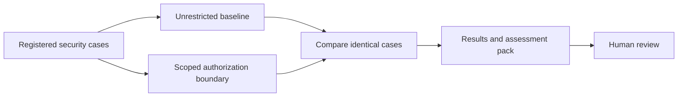

# Security pipelines

Repeatable security checks with evidence you can inspect. Built by **Rahul Chamoli / KaizenxRyu**. Start with agent tool boundaries, then add independently tested AI, cloud and software security pipelines.

**Available now:** an offline authorization replay and an automatically generated ten-document assessment pack. **Not yet evaluated:** real language models, Microsoft ASSERT, ACS enforcement or production systems. This repository is independent of Microsoft.



## Run the first pipeline

Use Python 3.12 or newer from this repository root. No packages or provider credentials are required.

```bash
python -m unittest discover -s tests -v
python -m security_pipelines demo --out artifacts/run-001
```

Open `artifacts/run-001/assessment/index.html` for the visual high-level evaluation, or `report.html` for detailed counts. Use a new directory for each run. Exit codes: **0** offline PASS, **1** expectation FAIL, **2** input or reporting error. An older report is not evidence of a successful new run.

The 40 synthetic cases include eight legitimate requests and 32 forbidden requests. They cover account isolation, caller-supplied privilege fields, lexical file scope, reference URLs and unsupported tools. Both variants receive the same cases; blocking a legitimate request also fails. The unrestricted baseline is deliberately insecure and never executes a tool.

## Assessment documents generated with every run

| Document | Purpose |
| --- | --- |
| Executive evaluation | Findings, scope and limits for decision-makers |
| High-level design | Components and trust-boundary flow |
| Model and tool inventory | What actually ran and what is absent |
| Data flow and privacy | Data movement, retention and unresolved obligations |
| Threat model | Attack paths, controls and remaining exposure |
| Evaluation plan and results | Evidence, paired outcomes and checks not run |
| Risk register and remediation | Open issues, owners and next actions |
| Governance coverage | High-level NIST AI RMF mapping and missing requirements |
| Operations and incidents | Failure, recovery and escalation approach |
| Review and release decision | Human sign-off and production approval pending |

Markdown keeps the documents editable. The HTML overview contains a native diagram and prints to PDF. A JSON manifest links document hashes to the exact source result and suite fingerprint. This is a practical assessment starter; company, sector and jurisdiction requirements must be scoped separately. No compliance certificate is issued by the pipeline.

## Microsoft ASSERT integration

Microsoft's `run-assert-eval` workflow provides a route from behavioral requirements to model evaluations and reviewed controls. See [the integration guide](docs/assert-integration.md) and [dated primary sources](docs/sources.md). Live model evaluation is intentionally inactive until a target, budget, credentials, trusted execution and baseline are configured. The tested Python boundary is not ACS.

## Add another pipeline

Use a named case suite, explicit expectations, a focused runner and honest reports. Add failure tests and legitimate-use checks before enabling CI. Proposed next modules: indirect prompt injection and answer leakage, MCP permissions, Azure configuration, dependency/secrets scanning and infrastructure policy. They are a roadmap, not installed integrations.

```text
security_pipelines/   contracts, policy, replay and assessment generation
suites/              versioned synthetic checks
tests/               boundary, error and evidence integrity checks
.github/workflows/   credential-free offline CI
docs/                intent, architecture, sources, findings and runbook
artifacts/           ignored generated results; never commit customer evidence
```

[Runbook](docs/runbook.md) · [Architecture](docs/architecture.md) · [Status](docs/status.md) · [Security findings](docs/security-findings.md) · [Contributing](CONTRIBUTING.md)

MIT license. Do not submit credentials, private customer material or internal company source in issues or reports.
