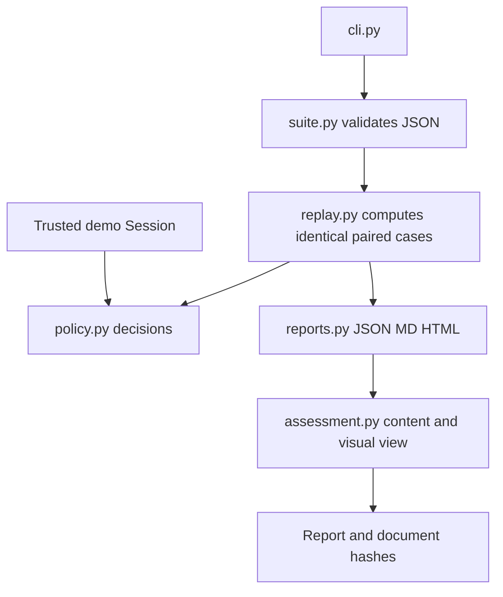

# Architecture and decisions

Owner: Codex. Scope: a local CLI security demonstration and evidence pack, not an AI service. Python standard-library modules separate input validation, policy, replay, reporting and assessment content/view. There is no runtime dependency lock because there are no third-party runtime packages.

## Decisions

1. Use deterministic authorization fixtures first. They are fast, credential-free and reproducible; they do not measure model behavior.
2. The trusted context is separate from proposed tool arguments. Exact schemas reject caller privilege fields; unsupported tools deny.
3. Compare identical fixtures, and measure unsafe allowance and legitimate blocking separately. Neither a changed suite nor overrefusal is an improvement.
4. Emit only case labels, expected/actual decisions and reason categories. Omit tool arguments from results.
5. Keep live ASSERT inactive. Its provider access, target execution and transitive dependencies require a separate review and explicit cost authorization.
6. Generate reports from observed counts, with production approval and reviewer sign-off pending. Templates never become signed assessments by being rendered.

The lexical file and URL policies are demonstration contracts. A production host must also enforce canonical filesystem containment, symlink/junction handling, redirects, DNS resolution, egress and actual authentication. Returning `allowed` alone cannot enforce a tool dispatch.
