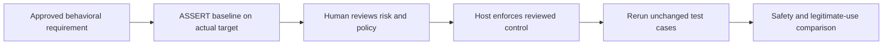

# Integrating a real model evaluation

**State: researched on 2026-10-12; not installed or run.** This demo does not call Microsoft ASSERT. Its synthetic suite cannot be supplied directly as an ASSERT YAML behavior config.

Use the upstream [ASSERT examples](https://github.com/responsibleai/ASSERT/tree/49848007ee2d4e208a5cf53a046f4ef164860720/examples) to define a behavior and real target callable, then run `assert-ai run --config your-approved-config.yaml`. Select a provider/model explicitly. No provider is configured here.

The [ACS guide](https://github.com/responsibleai/ASSERT/blob/49848007ee2d4e208a5cf53a046f4ef164860720/docs/guides/securing-agents-with-acs.md) documents `assert-ai acs generate`, `validate` and `eval-config`. ACS means **Agent Control Specification**. Generation is not host enforcement. The simple `guard_target` wrapper covers input/output; tool boundaries need host integration. Policy generation requires review before use, including block expectations.

For hosted evaluation, review Microsoft's existing [assert-ai-action](https://github.com/responsibleai/assert-ai-action/tree/4e22663a2b47db41712a01fb70cd66534410662e). It supports `configs`, `baseline`, `assert-ai-ref` and `provider-env`. Pin the reviewed harness and action. Its upstream composite uses moving nested action tags and unlocked installs; the outer SHA alone does not pin that whole environment.

## Activation checklist

- Owner approves the real system, permitted data transmission, provider budget and evaluation requirements.
- Review trusted target code before exposing credentials; model and PR content are untrusted.
- Configure scoped credentials in a protected environment, not source or command arguments. Masking does not stop evaluated code reading secrets.
- Capture baseline and controlled results using matching cases and harness revisions. Preserve provenance and restrict raw trace access.
- Treat missing baseline, changed test sets and inconclusive statistics as pending review. The upstream action may stay green in these states; require a deliberate release decision.
- Run safety and legitimate-use checks, verify controls actually stop dispatch, and exercise failure/recovery paths.
- Pin/review the complete dependency and action chain before a company release. Record observed spend and remaining findings.

No live workflow is included under `.github/workflows/`. This checklist is preparation, not execution evidence.
